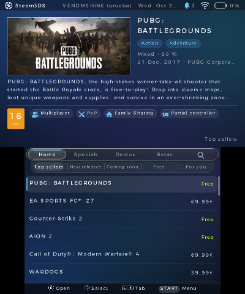
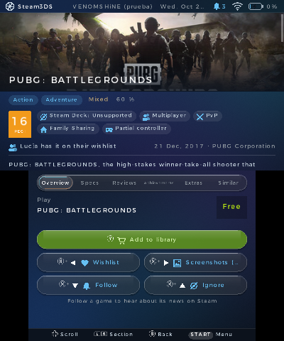
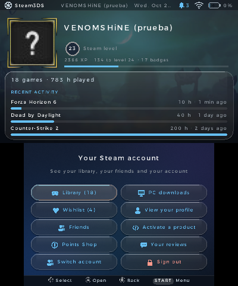
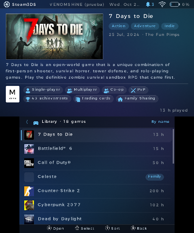
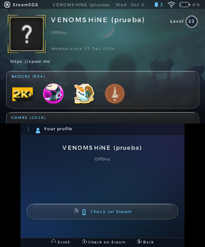
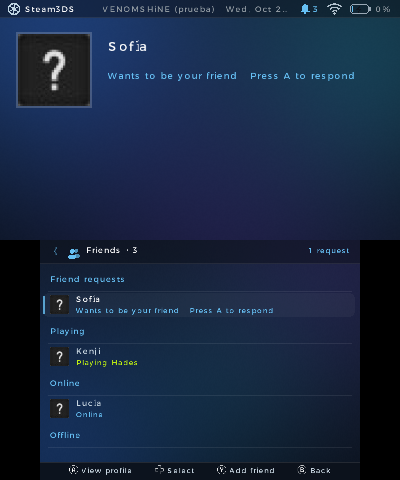
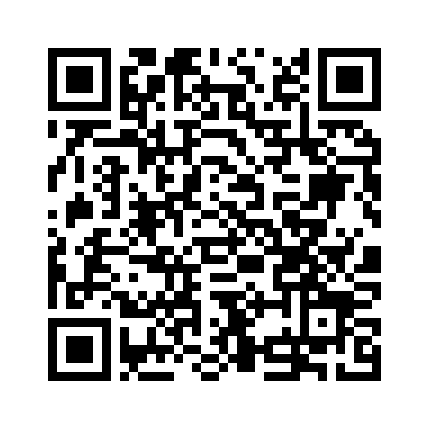

# Steam3DS

**Steam en tu Nintendo 3DS.** Explora la tienda, compra, regala y gestiona tu cuenta de Steam desde la consola: biblioteca, amigos, perfil, notificaciones y descargas de tu PC. Sin PC encendido ni servidores intermedios: habla directamente con Steam.

*English below · [Read in English](#english)*

<a href='https://ko-fi.com/W3A028X2KV' target='_blank'></a>

<p align="center">
  
  
  
</p>
<p align="center">
  
  
  
</p>

## Descargar e instalar



**Instalar sin cables con FBI (recomendado)**
1. En la 3DS abre **FBI** → *Remote Install* → *Scan QR Code*.
2. Escanea el código QR de la derecha. Descarga siempre la última versión del `.cia`.
3. Steam3DS aparece en el menú HOME.

**Instalar a mano**
- **`.cia`**: descarga `Steam3DS.cia` de la [última versión](https://github.com/venomshine/Steam3DS/releases/latest), cópialo a la SD e instálalo con FBI.
- **`.3dsx`**: copia `Steam3DS.3dsx` a `sd:/3ds/` y ábrelo desde el Homebrew Launcher.

Necesitas una consola con homebrew (por ejemplo, con [3ds.hacks.guide](https://3ds.hacks.guide/)) y conexión Wi-Fi. Funciona en 3DS, 2DS, New 3DS y New 2DS, y va más fluido en New 3DS / New 2DS.

## Iniciar sesión

1. Abre Steam3DS y pulsa **START** → **Iniciar sesión con el móvil**. Aparece un **código QR**.
2. En el móvil, abre la **app de Steam**, toca el escudo de **Steam Guard**, elige *Escanear un código QR* y apunta a la consola.
3. Confirma el inicio de sesión en el móvil. La primera vez, lee las **condiciones de uso** hasta el final y acéptalas.

La sesión se guarda solo en tu tarjeta SD (`sd:/3ds/Steam3DS/`). Puedes tener **varias cuentas** y cambiar entre ellas. Si pierdes la tarjeta, cierra la sesión desde la web de Steam (*Detalles de la cuenta → Gestionar dispositivos*).

Sin iniciar sesión también puedes explorar la tienda.

## Funciones

- **Tienda:** Inicio con Más vendidos, Novedades, Próximamente, Gratis y «Para ti» (tu cola de descubrimiento); Ofertas, Demos y Betas; **Buscar** con filtro de precio, las búsquedas populares del momento y explorar el catálogo sin escribir.
- **Ficha de cada juego:** capturas y vídeos, requisitos, opiniones con filtros (y en otros idiomas si no hay en el tuyo), logros y comparación con amigos, DLC, similares, compatibilidad con Steam Deck, noticias oficiales, seguir e ignorar.
- **Comprar:** carrito, lista de deseos (con orden, solo ofertas y avisos de rebajas) y **regalar** a un amigo con dedicatoria. Pago con el **monedero de Steam** o tu **tarjeta guardada**, con la verificación del banco por QR. Juegos y demos gratis a la biblioteca, y activar códigos de producto y del monedero.
- **Biblioteca** como la del cliente de Steam: sin tus juegos ocultos (con vista «Ocultos») ni los playtests cerrados, los juegos que van dentro de otro agrupados (Call of Duty, Battlefield), tus demos y tu **Familia de Steam**. Sale al momento y se actualiza por detrás.
- **Perfil** (el tuyo y el de tus amigos, según su privacidad): nivel, insignias, ilustraciones (también GIF), actividad reciente, juegos, capturas, reseñas, vitrinas, grupos y comentarios.
- **Amigos** en tiempo real, solicitudes y código de amigo. Apareces **«En línea»** mientras usas la app (se puede desactivar).
- **Notificaciones** al momento, **descargas de tu PC** (pausar, reanudar, desinstalar) e instalación remota, tienda de puntos, premios a reseñas, historial de compras, «Tus reseñas», privacidad y tema del perfil.
- Fecha, hora, Wi-Fi y batería en la pantalla superior.
- Idiomas: **español, inglés y japonés** (o el de la consola).

Ninguna acción que cambie tu cuenta (comprar, regalar, canjear, desinstalar…) se hace sin que la confirmes en la consola.

## Controles

| Botón | Acción |
|---|---|
| **A** | Abrir / elegir |
| **↑ ↓** | Moverse por las listas |
| **L / R** | Cambiar de pestaña o de apartado |
| **X + cruceta** | En la ficha: lista de deseos (←), capturas (→), seguir (↓) e ignorar (↑) |
| **Y** | Ordenar (biblioteca y lista de deseos) |
| **B** | Atrás |
| **START** | Menú (mantenlo pulsado para salir) |

Todo se puede hacer también con la pantalla táctil.

## Condiciones de uso

Al iniciar sesión con una cuenta por primera vez (y cada vez que cambien) hay que leer las condiciones de uso y el aviso legal hasta el final y aceptarlas. Cada cuenta deja un registro firmado en la SD (`sd:/3ds/Steam3DS/aceptacion_<cuenta>.txt`). Si se cambia a mano o se copia de otra consola, deja de valer y Steam3DS vuelve a pedir las condiciones.

## Privacidad

- Solo se conecta con Steam: la tienda, la comunidad, la API web y sus servidores oficiales, estos últimos como lo hace el chat web de steamcommunity.com.
- **«Aparecer en línea»** se puede desactivar en *Configuración*. El estado es de toda tu cuenta: si estabas «Invisible» en otro dispositivo, con la opción activada pasas a «En línea».
- El registro de diagnóstico (`sd:/3ds/Steam3DS/net.log`) no guarda contraseñas, tokens ni cookies.

## Errores y sugerencias

¿Algo falla o se ve raro? Abre un [issue](https://github.com/venomshine/Steam3DS/issues) o escríbeme en [Discord](https://discord.com/invite/yVKp8JwV4e). El archivo `sd:/3ds/Steam3DS/net.log` ayuda mucho a encontrar el problema. Si quieres apoyar el proyecto, invítame a un café:

<a href='https://ko-fi.com/W3A028X2KV' target='_blank'></a>

## Compilar desde el código

1. Instala [devkitPro](https://devkitpro.org/wiki/Getting_Started) con el paquete *3DS Development*.
2. Instala las librerías y compila:
   ```
   dkp-pacman -S 3ds-dev 3ds-curl 3ds-mbedtls 3ds-libpng 3ds-libjpeg-turbo 3ds-zlib
   make
   ```
   Se genera `Steam3DS.3dsx`. Sin devkitPro instalado, `./mk.sh` compila con su imagen oficial de Docker.
3. Para el `.cia`, pon [`bannertool`](https://github.com/Steveice10/bannertool) y [`makerom`](https://github.com/3DSGuy/Project_CTR) en el PATH y ejecuta `./tools/build_cia.sh`.

Los registros de aceptación de las condiciones se firman con la clave de `secret/terms.key`, que no está en el repositorio. Sin ella, la compilación firma con una clave de pruebas.

```
source/   código de la app
  main.c          arranque, bucle principal e interfaz (tienda, ficha, cuenta, perfil…)
  steam.c         tienda, comunidad y API web de Steam (peticiones y lectura de respuestas)
  auth.c          inicio de sesión por QR, varias cuentas y sesión web
  cm.c            conexión con los servidores de Steam (ocultos, licencias, playtests y «En línea»)
  shop.c pay.c    carrito, lista de deseos, regalos y pago
  net.c           hilo de red (libcurl + mbedTLS), caché y registro
  img.c           imágenes en cola (JPEG/PNG/GIF)
  ui.c fx.c sfx.c gráficos, efectos y sonido
  i18n.c          idiomas (la tabla i18n_table.h se genera con tools/gen_i18n.py)
lib/      cJSON, QR Code generator
romfs/    gráficos, sonidos y certificados raíz
meta/     icono, banner, sonido y configuración del .cia
tools/    arte, traducciones, empaquetado del .cia y comprobador de aceptaciones
tests/    pruebas de lectura de datos y relé para el emulador
```

Para añadir o corregir traducciones, edita `tools/i18n_tr.py` y ejecuta `python3 tools/gen_i18n.py`.

---

## English

**Steam on your Nintendo 3DS.** Browse the store, buy, gift and manage your Steam account from the console: library, friends, profile, notifications and your PC's downloads. No PC running and no middleman servers: it talks to Steam directly. The interface is available in Spanish, English and Japanese.

**Install:** open **FBI** → *Remote Install* → *Scan QR Code* and scan the QR above, or download `Steam3DS.cia` / `Steam3DS.3dsx` from the [latest release](https://github.com/venomshine/Steam3DS/releases/latest).

**Sign in:** press **START** → *Sign in with your phone* and scan the QR code with the **Steam mobile app** (*Steam Guard → Scan a QR code*). The first time, read the terms of use to the end and accept them. Your session is stored only on your SD card, and you can keep several accounts.

**Features:** the full store (top sellers, new releases, specials, demos, betas, search with price filter), complete game pages (screenshots, requirements, reviews, achievements, Steam Deck, news), cart, wishlist, gifts and checkout with your Steam Wallet or saved card. Your library works like the Steam client's (hidden games, closed playtests and bundled games are left out; demos and Steam Family included), plus profiles, friends in real time, notifications, remote downloads on your PC, points shop and purchase history. You appear online while using the app (can be turned off in Settings).

**Build:** devkitPro with `3ds-dev 3ds-curl 3ds-mbedtls 3ds-libpng 3ds-libjpeg-turbo 3ds-zlib`, then `make` (or `./tools/build_cia.sh` with bannertool and makerom for the `.cia`).

Bugs and ideas: [issues](https://github.com/venomshine/Steam3DS/issues) or [Discord](https://discord.com/invite/yVKp8JwV4e).

---

Hecho por **VENOMSHiNE** · [GitHub](https://github.com/venomshine) · [Discord](https://discord.com/invite/yVKp8JwV4e) · [Ko-fi](https://ko-fi.com/venomshine)

Steam3DS es un proyecto no oficial y no está afiliado a Valve Corporation ni a Nintendo. Steam y el logotipo de Steam son marcas de Valve Corporation. *Steam3DS is an unofficial project, not affiliated with Valve Corporation or Nintendo.*

## Licencia

Steam3DS es software libre bajo la **[GNU GPL v3](LICENSE)** con términos adicionales de atribución ([NOTICE.md](NOTICE.md)):

- Puedes usar, estudiar y modificar el código, pero lo que hagas con él también debe ser de código abierto bajo la GPL-3.0.
- **Debes dar crédito visible** en tu README y en la pantalla de créditos o «Acerca de» de tu app:
  > Basado en Steam3DS de VENOMSHiNE — https://github.com/venomshine/Steam3DS
- No puedes presentarlo como tuyo, y las versiones modificadas deben indicar que lo son.

*License: GNU GPL v3 with additional attribution terms — see [NOTICE.md](NOTICE.md).*

Incluye cJSON (MIT), QR Code generator de Project Nayuki (MIT) y los certificados raíz de Mozilla (MPL 2.0), y se enlaza con libctru, citro2d y citro3d (zlib), libcurl (curl), Mbed TLS (Apache 2.0), libpng (libpng), libjpeg-turbo (IJG/BSD) y zlib (zlib), que conservan sus licencias.
